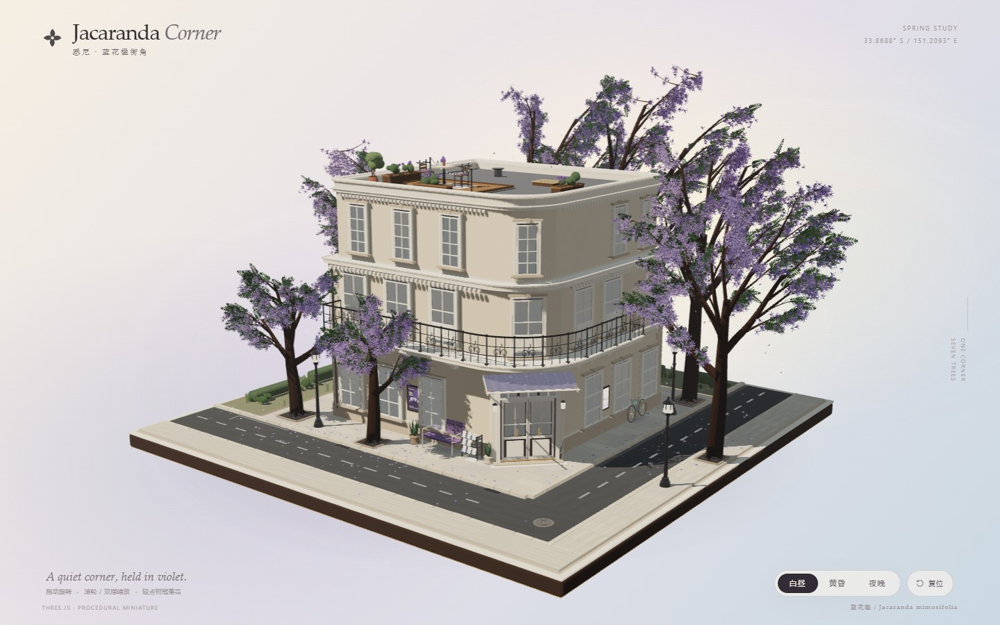
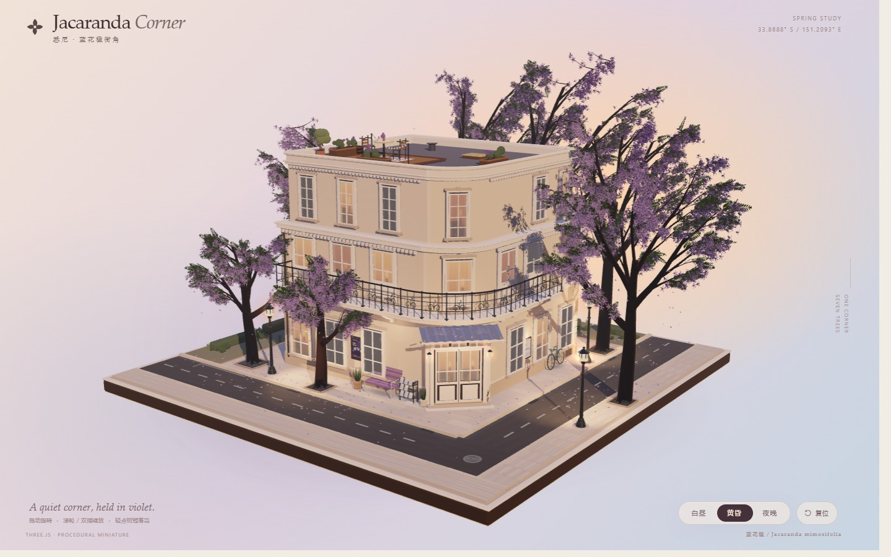
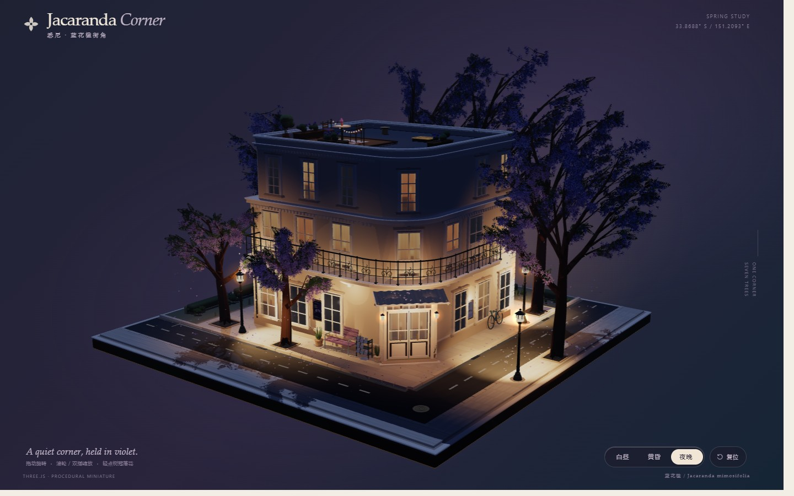
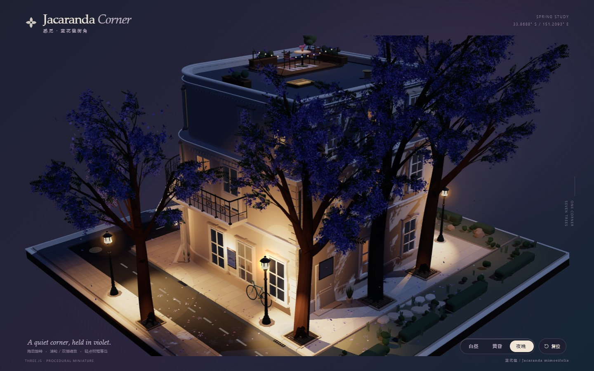
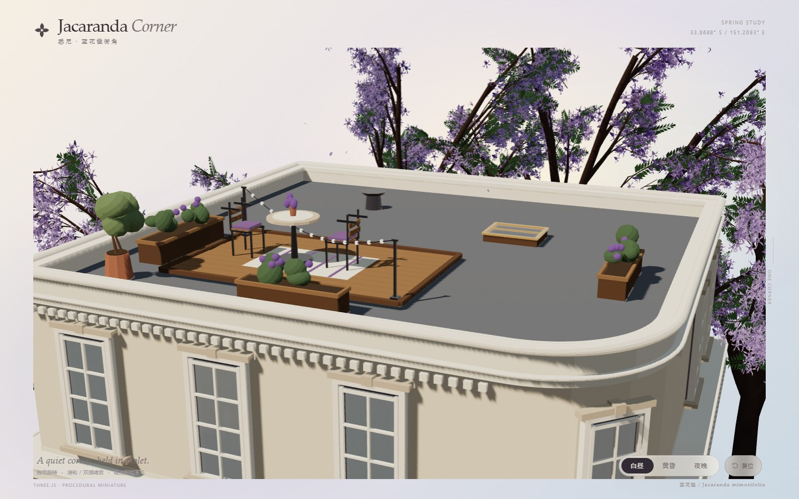

# Jacaranda Corner · 蓝花楹街角

一座以悉尼历史街区街角为原型的 Three.js 交互微缩场景。建筑、街道、树木、花朵、灯具与所有纹理均由代码生成，不依赖外部图片或 CDN。



## Run

```bash
npm start
```

然后打开 [http://127.0.0.1:4173](http://127.0.0.1:4173)。

无需 `npm install`：运行所需的 Three.js 已随项目放在 `vendor/` 中，本地服务器只使用 Node 内置模块。也可以直接执行：

```bash
node server.mjs
```

> 页面使用 ES modules + import map，需要通过 HTTP 服务打开，不能直接双击 `index.html`。

## Controls · 操作

- **旋转 / Rotate**：鼠标左键拖动，或触屏单指拖动
- **缩放 / Zoom**：滚轮或触屏双指捏合
- **复位 / Reset**：右下角复位按钮，平滑回到默认机位
- **时间 / Time**：白昼、黄昏、夜晚之间平滑切换，相机位置保持不变
- **落花 / Petals**：点击或轻触任意树冠，会摇动树梢并落下一阵花瓣

## Preview

| Dusk | Night |
| --- | --- |
|  |  |

Rear three-quarter view, after dark:



The added rooftop terrace:



## Scene notes

- **建筑**：奶油白三层转角小楼，连续圆弧立面、砂岩基座、分楼层檐线、独立窗套与窗台、三楼低矮弧形女儿墙和深色屋顶平台。
- **入口**：转角处白色双扇门，玻璃上亮、门框、下部嵌板与黄铜把手；上方瓦楞雨棚带檐边、支撑拉杆和金色墙座。
- **阳台**：仅二楼设置绕转角铁艺阳台，包含连续弧形扶手、细立柱、卷草花纹与白色托架。
- **树**：七棵种子化生成的蓝花楹，逐棵拥有不同的主干弯曲度、倾斜方向、分叉位置、高度与枝条密度。枝条为逐级收细、两端封口，并增加了细花梗和多级分叉；每棵约 400 束羽状叶簇，让树冠比初版更繁茂。高树冠层跨过屋脊，依然保留透光空隙与可见主枝。
- **花**：约 20,000 朵五裂喇叭形花，单棵树的全部花朵合并为一个 `InstancedMesh`；附加细花梗、下垂花簇、密集羽状叶簇、飘落花瓣与落在雨棚、窗台、长椅和铺地上的完整落花。
- **环境**：程序化街道、路缘石、排水沟、井盖、树池格栅、道路标线、海报、刊物架、紫色条板长椅、盆栽、自行车和四盏路灯。
- **屋顶**：隐藏式木平台、铁艺小圆桌与两把椅子、条纹地毡、三组花槽/盆栽、暖色串灯、玻璃天窗与原有通风帽组成的小型屋顶露台。
- **光照**：日间中性日光；黄昏加入倾斜暖光和蓝紫补光；夜间蓝紫环境光配合窗内、入口、雨棚、四盏路灯及屋顶串灯的局部暖光。树冠与花朵的遮挡阴影由方向光/聚光灯产生。
- **艺术处理**：Toon 分层明暗、纯色材质、物理玻璃环境反射、金属高光、程序化接触阴影与轻微纸纹颗粒；没有粗黑描边或复古滤镜。

## Technical summary

- 场景只构建一次。时间切换仅插值灯光、雾、玻璃、窗光、发光材质和曝光，不会重建场景或相机。
- 所有重复对象使用共享几何/材质与实例化：花朵、落地花瓣、飘落花瓣、树池格栅、路缘石、灌木、栏杆立柱、卷草花纹。
- 每棵树的数百根枝条合并成一个几何体；七棵树的枝条仅在各自组内合并。新增的叶簇、花梗和屋顶植被同样复用共享几何。
- 阴影贴图静态缓存，时段过渡期间按节流频率刷新，避免每帧重绘全部树冠阴影。
- 渲染使用 PCF 阴影、ACES tone mapping、设备像素比上限和移动端较低粒子数。
- 无网络资源请求；`preview/` 中的图片只用于说明。

### Verification performed

- Chromium / Intel Iris Xe at 1440 × 900 and mobile 390 × 844.
- 正面、侧后方、夜景实际渲染检查；树冠/花朵与墙体、屋顶及其新装饰的体积复核未发现可见穿模。
- 鼠标旋转、滚轮缩放、触屏单指旋转、双指缩放、复位、时段切换、树冠点击落花均通过。
- 当前 Intel Iris Xe 测试机在 1440 × 900 约 35–45 fps（约 1.85M triangles、约 550 draw calls，密集花冠为主要开销）；无运行时错误或警告。

## Project layout

```text
index.html             page shell and UI
src/style.css          responsive editorial layout, paper grain, day/dusk/night themes
src/main.js            renderer, camera rig, resize, raycasting, animation loop
src/worldConfig.js     dimensions, palette ranges, seven tree and four lamp placements
src/building.js        corner building, facade, windows, entrance, awning, balcony, parapet
src/roofTerrace.js     rooftop deck, bistro set, planters, festoon lights and skylight
src/ground.js          plinth, streets, sidewalks, curbs, drains, tree pits, garden
src/trees.js           seeded procedural jacarandas, collision-safe branches and blossoms
src/props.js           bench, bicycle, rack, pots, street lamps, contact shadows
src/fx.js              fallen and falling petals, fallen whole blossoms, base shadow
src/atmosphere.js      lighting/time presets and smooth transitions
src/materials.js       shared toon/physical materials and procedural textures
src/utils.js           geometry helpers, seeded RNG, textures, tapered branch tubes
vendor/                local Three.js build and addons (MIT)
server.mjs             dependency-free static server
preview/               rendered preview images
```

## Library

Three.js r187, MIT licensed. See [vendor/LICENSE-three.txt](./vendor/LICENSE-three.txt).
